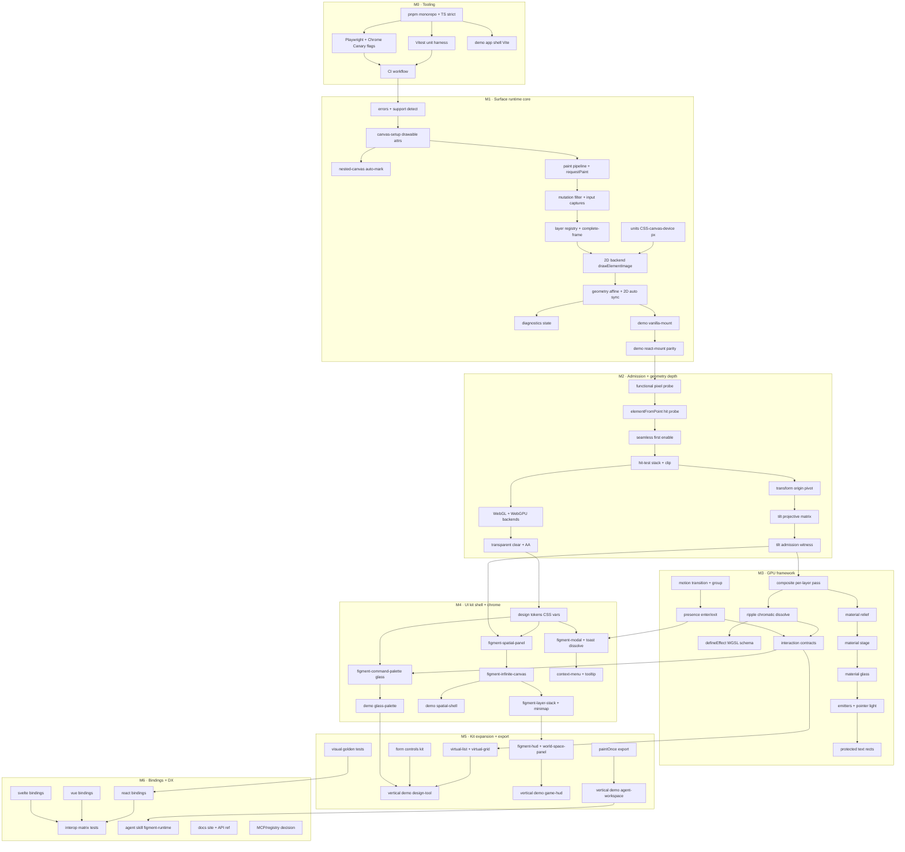

# figment — Implementation Plan

**Architecture:** [ARCHITECTURE.md](./ARCHITECTURE.md) · **Context:** [EXEC_SUMMARY.md](./EXEC_SUMMARY.md) · [FEATURES.md](./FEATURES.md)
**Constraint:** Chrome HTML-in-Canvas OT only. Missing API ⇒ `FigmentUnsupportedError`. **No fallback.**
**Author identity for commits:** `bsaranga <bsaranga@gmail.com>`

---

## 1. Milestone map

| ID | Name | Outcome | Depends on |
|---|---|---|---|
| **M0** | Tooling & repo | monorepo builds, tests run, CI green, Canary harness | — |
| **M1** | Surface runtime core | mount any DOM → 2D canvas, paint, hit-test, units | M0 |
| **M2** | Admission + geometry depth | functional probes, hit stack, tilt/projective layers | M1 |
| **M3** | GPU framework | effects, materials, emitters, motion, `defineEffect` | M2 |
| **M4** | UI kit — shell + chrome | InfiniteCanvas, SpatialPanel, CommandPalette, Modal, Toast | M2 (M3 for presets) |
| **M5** | Kit expansion + export | VirtualList, HUD, forms, `paintOnce`, verticals | M3, M4 |
| **M6** | Framework bindings + DX | react/vue/svelte, agent skill, docs | M4 |

Parallelism: M3 and M4 can overlap after M2. M6 is additive.

---

## 2. TODO-graph



### Dependency edges (machine-readable)

```text
M0a → M0b, M0c, M0d
M0b → M0e;  M0c → M0e
M0e → M1a
M1a → M1b → M1c
M1b → M1d → M1e → M1g → M1h → M1i → M1j
M1f → M1h
M1i → M1k → M1l
M1l → M2a → M2b → M2c → M2d → M2e → M2f → M2g
M2d → M2h → M2i
M2g → M3a;  M2i → M4a;  M2g → M4b
M3a → M3b → M3k;  M3a → M3d → M3e → M3f → M3g → M3h
M3b → M3c;  M3i → M3j → M3k
M3k → M4e;  M3j → M4f;  M3k → M5a
M4a → M4b → M4c → M4d → M5c
M4a → M4e → M4i → M5e
M4a → M4f → M4g
M4c → M4h
M5a → M5e;  M5b → M5e;  M5c → M5f;  M5d → M5g
M5h → M6a;  M5g → M6e
M6a → M6d;  M6b → M6d;  M6c → M6d
```

---

## 3. Milestone breakdown (digestible units)

### M0 — Tooling & repo

| ID | Task | Size | Done when |
|---|---|---|---|
| M0a | pnpm workspace, TS strict, package stubs (`host`/`gpu`/`ui`) | S | `pnpm install && pnpm build` works |
| M0b | Vitest unit setup | S | one sample geometry test green |
| M0c | Playwright + Chrome Canary + HTML-in-Canvas flags harness | M | one browser test draws a `drawable` div |
| M0d | Vite demo shell (`demos/vanilla-mount`) | S | `pnpm dev` serves empty host demo |
| M0e | CI (typecheck, unit, browser) | M | CI green on PR |

### M1 — Surface runtime core

| ID | Task | Size | Done when |
|---|---|---|---|
| M1a | `FigmentUnsupportedError` + support detection (presence + arity) | S | throws clearly without API |
| M1b | `canvas-setup`: `content="drawable"` + `drawable` management | S | WICG basic example runs via host |
| M1c | Nested-canvas auto-mark/restore (crbug 576333009 workaround) | M | nested canvas captures pixels; restored on destroy |
| M1d | Paint pipeline: `paint` coalescing, `requestPaint`, dirty set | M | only changed layers redraw |
| M1e | Mutation filter (same-value, side-effect attrs) + input/focus captures | M | slider drag updates pixels; `setAttribute(same)` does not recapture |
| M1f | `units.ts`: CSS ↔ canvas ↔ device px + ResizeObserver | M | crisp text at DPR 1 and 2 |
| M1g | Layer registry + complete-frame membership gating | M | add/remove layers never flashes blank |
| M1h | 2D backend `drawElementImage` (3/5/7/9-arg) | S | forms interactive and drawn |
| M1i | Affine geometry + 2D auto sync + `clearElementGeometry` | M | clicks land on drawn controls |
| M1j | `diagnostics.state()` | S | backend/health/counters visible |
| M1k | `demos/vanilla-mount` | S | interactive form in canvas |
| M1l | `demos/react-mount` (same DOM via React) | S | pixel + hit parity with vanilla |

**M1 exit:** any FE framework's form is mountable, clickable, and crisp on 2D canvas.

### M2 — Admission + geometry depth

| ID | Task | Size | Done when |
|---|---|---|---|
| M2a | Functional pixel probe (known colors, readback) | M | probe passes on Canary 157+ |
| M2b | `elementFromPoint` hit probe at transformed points | M | hit proof recorded in `state()` |
| M2c | Seamless first enable (hidden probe, swap on complete) | M | no blank/flash on first frame |
| M2d | Hit-test stack, `preserveHitTestOrder`, `canvasClip` | M | overlapping panels click correctly |
| M2e | Transform origin / pivot | S | rotate about `center` works |
| M2f | Tilt: projective matrix (tiltX/tiltY/perspective) | L | tilted panel draws correctly |
| M2g | Tilt admission witness (refuse mode if hit-test wrong) | M | `tilt-unsupported` throws when probe fails |
| M2h | WebGL + WebGPU backends (pre-alloc, dict APIs) | L | same scene on all 3 backends |
| M2i | Transparent clear + bilinear premultiplied + analytic AA | M | no edge fringes when rotated |

**M2 exit:** tilted panels with correct clicks on 2D/WebGL/WebGPU; fail-fast when browser can't.

### M3 — GPU framework

| ID | Task | Size | Done when |
|---|---|---|---|
| M3a | Per-layer composite pass (no staging 2D) | M | direct GPU upload path live |
| M3b | Effects: ripple, chromatic, dissolve | M | each demoable on a layer |
| M3c | `defineEffect` WGSL schema + compile-then-publish | L | custom effect from app code |
| M3d | Material: relief (bevel/depth, brightness factor) | M | panel has depth, text contrast holds |
| M3e | Material: stage | S | decorative ground works |
| M3f | Material: glass (ior/tint/dispersion) | L | glass palette readable + refractive |
| M3g | Emitters + pointer light | M | light moves without recapture |
| M3h | Protected text rects | M | copy never illegible under light |
| M3i | Motion: `transition`, `transitionGroup` + stagger | M | keyed layer motion |
| M3j | `presence` enter/exit | M | toast dissolve uses it |
| M3k | Interaction contracts (`decorative`/`inert`/`material`) | M | violations throw; live controls only relit |

**M3 exit:** layers can wear glass/relief and run effects safely.

### M4 — UI kit (shell + chrome)

| ID | Task | Size | Done when |
|---|---|---|---|
| M4a | Design tokens (`--figment-*`) | S | themable in DOM + canvas |
| M4b | `<figment-spatial-panel>` (move/tilt, material presets) | M | draggable tiltable panel |
| M4c | `<figment-infinite-canvas>` (pan/zoom world space) | L | infinite board with panels |
| M4d | `<figment-layer-stack>` + `<figment-minimap>` | M | depth order + overview |
| M4e | `<figment-command-palette>` (glass preset, ⌘K) | M | usable palette on canvas |
| M4f | `<figment-modal>` + `<figment-toast>` (dissolve) | M | focus trap + presence exit |
| M4g | `<figment-context-menu>` + `<figment-tooltip>` | M | 3D-aware placement |
| M4h | `demos/spatial-shell` | M | Figma-like board demo |
| M4i | `demos/glass-palette` | S | palette + glass showcase |

**M4 exit:** a stranger can build a spatial tool UI from the kit.

### M5 — Kit expansion + export

| ID | Task | Size | Done when |
|---|---|---|---|
| M5a | `<figment-virtual-list>` / `<figment-virtual-grid>` | L | 10k rows at 60fps scroll |
| M5b | Form controls (input/select/slider/checkbox) | M | full keyboard + IME |
| M5c | `<figment-hud>` + `<figment-world-space-panel>` | M | accessible game HUD demo |
| M5d | `paintOnce()` export readiness | S | PNG export of a scene |
| M5e | Vertical: design-tool demo | M | shippable demo |
| M5f | Vertical: game-hud demo | M | shippable demo |
| M5g | Vertical: agent-workspace demo | M | shippable demo |
| M5h | Visual golden tests (DPR 1/2) | M | CI catches regressions |

**M5 exit:** three convincing verticals + export.

### M6 — Bindings + DX

| ID | Task | Size | Done when |
|---|---|---|---|
| M6a | `@figment/react` thin bindings | M | React demo uses bindings |
| M6b | `@figment/vue` | M | Vue demo |
| M6c | `@figment/svelte` | M | Svelte demo |
| M6d | Interop matrix tests (4 frameworks × hit/pixel) | M | parity suite green |
| M6e | Agent skill `skills/figment-runtime` | S | agents install components correctly |
| M6f | Docs site + API reference | M | published docs |
| M6g | Distribution decision (npm vs registry) | S | ADR recorded |

**M6 exit:** any FE team can adopt in an afternoon.

---

## 4. Size legend & sequencing

- **S** ≤ 0.5 day · **M** ≤ 2 days · **L** ≤ 5 days
- Critical path: `M0 → M1 → M2 → M3 → M4 → M5 → M6`
- Fast followers: M1f units and M1b setup early; M3 and M4 share M2 geometry.

---

## 5. Risks → plan reactions

| Risk | Plan hook |
|---|---|
| API churn in OT | M1a centralizes detection; browser matrix in M0c |
| Tilt hit-test bugs | M2g refuses mode; documented in errors |
| Nested canvas blank capture | M1c ships the known workaround first |
| Perf on canvas lists | M5a virtualization is explicit scope |
| Framework drift | M6d interop matrix is a gate, not optional |

---

## 6. Working agreement

1. Commits use author `bsaranga <bsaranga@gmail.com>` (override via env/`--author`; do not rewrite global git config).
2. No fallback code paths. Ever.
3. Each task closes with: unit test, and/or browser test, and/or visible demo delta.
4. Update [FEATURES.md](./FEATURES.md) when steal-list items ship.
